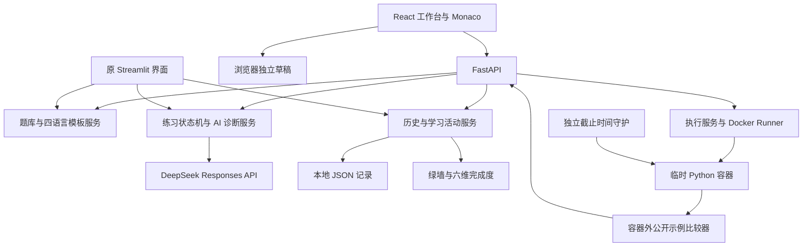

# AI Programming Tutor · V3 Workbench

基于现有 Python 业务服务的算法练习与渐进式编程辅导工具。新版采用 React + TypeScript + Monaco 三栏工作台，支持 Python 3、Java、C、C++ 的编辑、独立草稿及 DeepSeek 静态诊断，并提供六维题库完成度画像。Python 两数之和已接入 Docker 网页运行。FastAPI 连接界面与既有服务；原 Streamlit + Ace 页面保留可运行。

本项目定位为**本地课程教学原型**。四语言编辑不等于四语言执行；当前只执行 Python + Two Sum 的一个公开示例，没有全部 32 题的正式本地判题，也不代表 LeetCode 官方 Accepted。它不是生产级恶意代码执行平台。

## 功能与交付范围

| 模块 | 当前能力 |
|---|---|
| 题库与路线 | 32 道精选题、8 个学习阶段、搜索筛选和推荐题单 |
| 编辑与草稿 | 四语言 Monaco、128 份独立模板、按题号和语言保存、备份导入与恢复 |
| AI 辅导 | DeepSeek Responses 结构化诊断、错误类型/知识点/分析、三级渐进 Hint |
| 学习记录 | 诊断历史、本地提交、用户自报通过、365 天绿墙 |
| 六维画像 | 按不同题号的自报完成度计算，不评估真实算法能力 |
| 网页运行 | Python + #1 两数之和，一个服务端公开示例；真实输出、错误、耗时和结果比较 |
| 兼容界面 | 原 Streamlit/Ace 页面继续保留 |

## 技术栈与系统架构

| 层次 | 技术 |
|---|---|
| 前端 | React、TypeScript、Vite、Monaco Editor、Recharts、Lucide React、CSS |
| 后端 | Python、FastAPI、Pydantic、Uvicorn；原 Streamlit 服务保留 |
| AI | DeepSeek Responses API、JSON Schema、python-dotenv、标准库 HTTP 客户端 |
| 存储 | JSON；浏览器 localStorage/sessionStorage；没有新增 SQLite 或云数据库 |
| 执行 | Docker Desktop + WSL2 Linux Engine；标准库管理受控 Docker CLI |
| 验证 | unittest、Vitest、React Testing Library、Playwright CLI、独立 Docker 集成测试 |



Runner 目前与本机 API 同进程，拥有 Docker 管理权限；独立守护只负责回收，不等于独立低权限执行 Worker。公网部署需要另行设计和安全评审。

## 目录结构

```text
D:\Projects\Python\ai-programming-tutor
├─ backend/              FastAPI；execution/ 为 M1 执行模块
├─ frontend/             React、Monaco、画像与运行结果界面
├─ services/             题库、诊断、Hint、历史和统计业务
├─ data/                 公开题库、扩展模板；个人记录不进 Git
├─ prompts/              诊断 Prompt
├─ pages/、utils/、app.py 原 Streamlit 页面及兼容工具
├─ scripts/              本地启动脚本
├─ tests/                Python、浏览器及 Docker 测试
├─ docs/                 架构与接口说明
├─ outputs/              审核后的报告、截图和验收摘要
└─ work/                 忽略的本地临时验收材料
```

## 环境要求

- 本轮验证环境：Windows、Python 3.10.20（Anaconda `ai-study`）、Node.js 24.14.1、npm 11.11.0。
- Python 3.10+；依赖以 `requirements.txt` 为准，前端依赖以 `frontend/package-lock.json` 为准。
- Docker 仅在运行代码时需要；本实现使用 `desktop-linux` context、Linux Engine 和本地 Python 镜像。
- AI 诊断需要网络和有效的服务端 DeepSeek 配置；浏览、编辑和草稿不需要模型请求。
- 建议演示时串行运行构建、回归与 Docker 测试，给 Windows/WSL 留足内存。

以下命令使用本机真实项目和 Python 路径；换机器时调整路径，不要照搬磁盘位置或覆盖现有环境。

## 新版工作台运行

在新环境首次安装依赖、构建前端时执行（已有 `.env` 和学习数据保持原样）：

```powershell
Set-Location 'D:\Projects\Python\ai-programming-tutor'
& 'D:\anaconda\envs\ai-study\python.exe' -m pip install -r requirements.txt
npm.cmd --prefix frontend ci
npm.cmd --prefix frontend run build
```

日常启动无需重新安装。先在 Windows 中打开 Docker Desktop；需要网页运行时，在同一 PowerShell 终端启用现有执行开关：

```powershell
Set-Location 'D:\Projects\Python\ai-programming-tutor'
$env:AI_TUTOR_EXECUTION_ENABLED = '1'
.\scripts\start_workbench.ps1
```

也可直接启动后端：

```powershell
& 'D:\anaconda\envs\ai-study\python.exe' -m uvicorn backend.app:app --host 127.0.0.1 --port 8000
```

使用单个 Uvicorn 进程，不加 `--workers`。执行默认关闭；不设置开关时，其他功能仍可使用。PowerShell 开关只影响当前进程环境，不需要改 `.env`。

前后端分开开发时，后端按上面命令运行，另开终端执行 `npm.cmd --prefix frontend run dev`，打开 `http://127.0.0.1:5173/`；Vite 已将 `/api` 代理到 8000。M1 执行的 Host/Origin 限定为本机 8000/5173，随意改端口可能被拒绝。

打开 `http://127.0.0.1:8000`。工作台、学习路线、绿墙与历史使用同一组题库和记录服务。编辑器草稿在当前浏览器按题目和语言持久化，刷新和切页可恢复，旧 Python 草稿继续读取；诊断不会覆盖代码。第一次从仍然打开的旧 Streamlit 会话迁移时，先在旧练习页「导出当前会话草稿到新版工作台」下载 JSON，再在新版草稿菜单导入，冲突保留新版已有稿。

开发模式、接口契约、迁移边界与验收方式见 [工作台说明](docs/workbench.md)；四语言、模板和能力画像规则见 [第三阶段说明](docs/phase3.md)。测试区现在可显示 Python 两数之和的真实运行结果；其他组合显示未开放说明。

## Docker 配置与 Python 网页运行

新增默认关闭的本机执行 API，支持 Python 两数之和的单个公开示例。代码与函数驱动仅在非 root、无网络、只读根文件系统的临时 Docker 容器内执行；外部控制时间、输出、内存与进程限制并确认清理。执行不调用 AI、不记录提交、不改变绿墙或能力画像。示例通过不代表正式本地测试集或 LeetCode Accepted。

Windows 安装 Docker Desktop 后，按[官方 WSL2 后端说明](https://docs.docker.com/desktop/features/wsl/)确认 WSL2 与 Linux 容器模式；Windows 原生终端不要求另装 Ubuntu。本轮不自动更改 Docker/WSL 配置。

```powershell
docker --context desktop-linux info --format 'OSType={{.OSType}} CPUs={{.NCPU}} Memory={{.MemTotal}} Security={{json .SecurityOptions}}'
docker --context desktop-linux image inspect python:3.12-slim --format '{{.Id}}'
# 仅当本地缺少镜像时，由负责人预先准备：
docker --context desktop-linux pull python:3.12-slim
```

运行服务不会自动拉镜像。默认策略为非 root、只读根目录、无外网、cap-drop ALL、no-new-privileges、默认 seccomp、128 MiB 内存、0.5 核 CPU、64 PID、3 秒墙钟、有限 tmpfs，以及 stdout/stderr 各 64 KiB；结束后确认容器回收。不挂载项目目录或 Docker Socket，不把宿主密钥传入容器。

网页选择 **#1 两数之和 → Python 3 → 运行公开示例**。执行 Token 只存内存；结果显示运行状态、输出、沙箱耗时与预期/实际值。编辑、切题或切语言使旧结果失效，原同步请求结束前不允许重复运行。没有取消接口，不能把浏览器停止等待说成容器已经取消。

API 与安全细节见 [M1 执行说明](docs/execution-m1.md)；前端接入见 [Day 1 验收报告](outputs/m3-lite-acceptance-report.md)。Java/C/C++ 执行尚未实现，原四语言编辑和草稿功能保留。旧 `/api/health` 中的 `execution_available=false` 不是当前执行能力判断依据；使用 `/api/execution/session` 的能力说明，并以实际运行结果为准。

## 保留的 Streamlit 运行方式

环境要求：Python 3.10+（本项目在 Python 3.10.20 的 `ai-study` 环境验证）。以下命令使用该环境；如果你的 Python 路径不同，请替换为实际路径。

在 PowerShell 中执行：

```powershell
Set-Location 'D:\Projects\Python\ai-programming-tutor'
& 'D:\anaconda\envs\ai-study\python.exe' -m pip install -r requirements.txt
if (-not (Test-Path -LiteralPath '.env')) { Copy-Item .env.example .env }  # 仅首次配置
& 'D:\anaconda\envs\ai-study\python.exe' -m streamlit run app.py
```

打开终端显示的本地网址。侧栏包含学习仪表盘、选题与练习、学习记录。依赖为 `streamlit==1.50.0`、`streamlit-code-editor==0.1.22` 和 `python-dotenv==1.2.2`，测试使用标准库 `unittest` 和 Streamlit 自带的 `AppTest`。

## 配置

首次使用请复制 `.env.example` 为 `.env`，填写服务端密钥。`.env` 已被 Git 忽略，不要提交；`.env.example` 只保留占位值，可以被 Git 跟踪。

| 变量                    | 必填        | 默认值                      | 说明                                                                                   |
| ----------------------- | ----------- | --------------------------- | -------------------------------------------------------------------------------------- |
| `DEEPSEEK_API_KEY`      | AI 诊断必填 | 无                          | 配置在服务端 `.env` 或进程环境变量中；不在页面、日志或 Git 中展示                      |
| `DEEPSEEK_MODEL`        | 可选        | `deepseek-flash`            | 当前项目白名单为 `deepseek-flash`、`deepseek-v4-pro`；其他值在联网前拒绝 |
| `AI_TUTOR_CATALOG_PATH` | 可选        | `data/problem_catalog.json` | 题库路径，主要用于测试或演示隔离；文件必须存在且结构合法                               |
| `AI_TUTOR_EXECUTION_ENABLED` | 可选 | `0` | 当前 PowerShell 中设为 `1` 开启 M1；无需修改密钥文件 |

`python-dotenv` 按 UTF-8 读取项目根目录 `.env`，`override=False`，已有进程环境变量优先。

**真实 API 已由项目负责人实际测试通过**（不属于自动化测试）。早期 Chat Completions 请求曾因模型响应缺少 `hints` 被严格校验拒绝；迁移到 Responses API 后，项目负责人已在本地实网验收。仓库内自动化测试仍只使用模拟 HTTP；默认模型、账号可用性和 Schema 参数需以你的账号和[官方文档](https://api-docs.deepseek.com/)为准。真实请求返回 400/422 时，请核对 `DEEPSEEK_MODEL` 与官方参数。

## 兼容版 Streamlit 功能（与新版共享 Python 服务）

- **学习仪表盘**：真实本地提交总数、用户自报通过的不同题目数、连续提交天数、下一推荐阶段。
- **八阶段路线**：数组与哈希表、双指针与滑动窗口、栈/队列/二分、链表、二叉树与递归、DFS/BFS/回溯、贪心、动态规划。
- **32 道精选题**：按精确题号、中文/英文题名搜索；难度筛选和算法标签组合筛选（所选标签全部匹配）；练习摘要、示例、约束、官方链接和 Python 模板。
- **在线代码编辑器**：练习页使用 `streamlit-code-editor`（Ace）提供 Python 语法高亮、行号、自动缩进和深色主题；左侧题目/编辑器、右侧 AI 诊断的在线工作台布局。
- **独立草稿**：每题通过 Session State 保存，编辑停顿、失焦、点击操作、切题或切页时同步，并可在返回时恢复；查看 Hint、诊断和重运行不会覆盖代码。草稿只在当前浏览器会话内保留，关闭或刷新会话前请自行备份。
- **渐进辅导**：DeepSeek 结合当前题目与代码生成分析、错误类型、知识点和三级 Hint。切题、修改代码或开始新诊断会清除旧结果及 Hint 进度；过时请求的响应不保存。
- **刷题绿墙**：过去 365 天，按北京时间统计主动记录的本地提交。颜色对应每日 0、1、2、3、4 次及以上；悬停查看日期和次数。
- **兼容历史**：保留旧记录、不完整记录及非字典异常条目；展示题号、题名、时间、Hint 使用、诊断来源、请求模型和用户自报通过状态。活动与诊断分别展示。
- **深色界面**：主题集中在 `.streamlit/config.toml`，布局及热力图样式集中在 `utils/ui.py`。

## 操作与统计的区别

| 操作                 | 保存位置                                  | 增加提交/绿墙          | 增加完成数     |
| -------------------- | ----------------------------------------- | ---------------------- | -------------- |
| AI 诊断 / 重新诊断   | `data/records.json`                       | 否                     | 否             |
| 运行公开示例         | 临时容器与内存结果，不写学习记录           | 否                     | 否             |
| 记录一次本地提交     | `data/activities.json`，`kind=submission` | 是，每次主动点击计一次 | 否             |
| 记录 LeetCode 已通过 | `data/activities.json`，`kind=accepted`   | 否                     | 按不同题号去重 |

通过按钮需要用户明确确认。这是**用户自报状态**，没有登录 LeetCode、查询判题结果或同步官方提交。M1 执行 API 与此按钮独立，执行结果不改写用户自报状态。

同题多次主动提交均计数；相同活动 ID 的重试只保存一次。普通重运行不会创建活动。没有明确日期/题号的旧诊断不会被猜测成提交或 Accepted。

连续天数以提交日计算：今天有提交时从今天向前计数；今天未提交但昨天有提交时，保留截至昨天的连续天数。仅标记通过不增加提交日。推荐第一个尚未全部标记通过的阶段，全部完成后保持第 8 阶段。

## AI 诊断的实际范围

练习页通过 `analyze_code(code, problem)` 调用 **DeepSeek Responses API**（`POST /responses`）。请求发送当前题目的摘要、示例、约束等上下文和代码，并通过 `text.format` 的 `json_schema` 约束 `error_type`、`knowledge`、`analysis` 和 `hints` 四个字段；`reasoning.effort=none` 关闭思考模式。`hints` 数组长度不由 schema 单独保证，仍由 `_strict_diagnosis` 要求恰好三条非空字符串。Prompt 保存在 `prompts/diagnose_prompt.txt`，要求只给启发和定位方向，不给完整答案；模型的教学质量仍需人工检查。响应缺字段、类型错误或 Hint 不合格时不会当作成功诊断保存。

服务端使用 `python-dotenv` 按 UTF-8 加载项目根目录 `.env`，`override=False`，已有进程环境变量优先。该文件只需配置 `DEEPSEEK_API_KEY`，可选 `DEEPSEEK_MODEL`；不在页面、日志或 Git 中展示密钥。每次点击会向 DeepSeek 发送代码，可能产生 API 费用，请勿在练习代码中放入秘密信息。

当前实现使用 [Responses API](https://api-docs.deepseek.com/guides/responses_api)，默认请求 `deepseek-flash`，请求参数包含 `reasoning: {"effort": "none"}`、`max_output_tokens: 1800` 和 `text.format` 的 `json_schema`。`DEEPSEEK_MODEL` 仅支持 `deepseek-flash` 与 `deepseek-v4-pro`；其他值会在发起请求前被拒绝。实现依据[Responses API 参考](https://api-docs.deepseek.com/zh-cn/api/create-response/)与[模型与价格](https://api-docs.deepseek.com/quick_start/pricing/)；**项目负责人已在本地实网测试通过**，该验收不属于仓库自动化测试。认证、余额、限流等状态参照[官方错误码](https://api-docs.deepseek.com/quick_start/error_codes/)。

HTTP 连接及读取操作设置 30 秒超时，不自动重试。401、402、429、超时、空响应、非法 JSON 和缺字段都会清楚报错并保留草稿；**不会自动回退为规则 / Mock**。本地规则仍作为显式兼容接口保留，其结果标为“本地规则 / Mock”，不冒充 DeepSeek。每次请求使用题号、代码和唯一请求标识隔离结果，编辑、切题或发起更新的请求后丢弃旧响应。

诊断属于模型静态分析，学生代码不会被执行，也不能证明代码正确或 LeetCode Accepted。Hint 初始只展示第一级，逐次展开到第三级；重新诊断从第一级开始。

## 题库来源与扩展

题库为随仓库提供的 `data/problem_catalog.json`，32 道经典题覆盖八阶段。题号、题名、难度和链接采用公开题目元数据；中文练习摘要与示例由本项目编写，**不是官方题面全文**。约束用于配套练习，完整题意、当前约束与判题以每题 LeetCode 官方链接为准。

本版本以本地题库为稳定默认来源，不调用未公开、可能变化或受限的 LeetCode GraphQL 接口，不批量抓取官方全文。因此离线或接口不可用时仍可搜索、筛选和练习；查看官方完整题面需要网络。本版本提供精选本地题库搜索，没有提供全量在线题库搜索。

读取题库时会校验 JSON 根节点、必填字段、字段类型、题号唯一性、难度枚举、学习阶段 1–8、标签/约束/示例结构及官方链接格式。文件缺失、JSON 损坏或结构非法时，仪表盘和练习页显示中文错误并停止渲染，不会静默当作空题库。校验结果按文件版本（路径、修改时间、大小）缓存，文件更新后自动重读；对外返回独立副本，页面不能修改缓存。空学习阶段是允许的，推荐阶段无题时页面会提示而不是崩溃。

扩展时按已有 JSON 对象增加唯一整数 `id`，以及 `title_zh`、`title_en`、`slug`、`difficulty`、`tags`、`stage`、`summary`、`examples`、`constraints`、`python_template`、`official_url`、`source_note`。阶段为 1–8；添加可合法使用的摘要/示例并核对官方元数据。回归测试检查题号唯一、阶段覆盖及模板语法。

## 数据保护与存储边界

正式诊断文件仍为 `data/records.json`，已有历史不做启动迁移、不删除条目。新诊断附带 `record_id`、`leetcode_id`、`title`、`created_at`、`hints_used`、`source`、`model` 和 `is_mock`；展开 Hint 只更新该条新记录。缺失的旧日期和来源等元数据展示为“未记录”，不推测旧记录来自模型。刷题活动独立保存到 `data/activities.json`，缺文件时读取为空活动，首次主动保存才创建。

两个本地数据文件均被 Git 忽略。读取和写入 `records.json` 时会拒绝 `NaN`、`Infinity`、`-Infinity` 等非标准 JSON 数值；普通 JSON 语法错误会报告中文行号、列号，不会把损坏文件当作空历史。保存采用完整读改写锁、同目录临时文件及原子替换；损坏 JSON 或错误根节点会报错，避免当作空历史覆盖。并发保障针对**单个 Python 进程中的多会话**；多进程部署需共享数据库或额外进程间锁。原子替换不等同于断电持久化，长期使用请备份数据目录。

测试或演示可用环境变量隔离数据：

```powershell
$env:AI_TUTOR_RECORDS_PATH = 'D:\Temp\ai-tutor-demo\records.json'
$env:AI_TUTOR_ACTIVITIES_PATH = 'D:\Temp\ai-tutor-demo\activities.json'
$env:AI_TUTOR_CATALOG_PATH = 'D:\Temp\ai-tutor-demo\problem_catalog.json'
& 'D:\anaconda\envs\ai-study\python.exe' -m streamlit run app.py
```

记录和活动路径可以不存在，首次保存时创建父目录；题库路径必须指向已存在且结构合法的 JSON 文件。结束后使用 `Remove-Item Env:AI_TUTOR_RECORDS_PATH, Env:AI_TUTOR_ACTIVITIES_PATH, Env:AI_TUTOR_CATALOG_PATH -ErrorAction SilentlyContinue` 恢复默认路径。

## 验证

```powershell
& 'D:\anaconda\envs\ai-study\python.exe' -B -m unittest discover -s tests -v
npm.cmd --prefix frontend test
npm.cmd --prefix frontend run typecheck
npm.cmd --prefix frontend run build
git diff --check
git diff --cached --check
git status --short
git check-ignore -v .env data/records.json data/activities.json
git status --short -- .env.example
```

自动化测试使用临时目录、虚构输入和模拟 HTTP 响应，不联网、不加载真实密钥、不写正式学习记录或提交数据。覆盖 DeepSeek Responses 结构化请求参数与输出解析、状态/空输出/非法 JSON/超时等失败响应、三级 Hint、草稿及过时请求隔离、题库缺失/损坏/结构校验/空阶段/缓存刷新、records 非法 JSON 与非标准常量、活动幂等/并发、提交与通过分离、365 天热力图、时区与连续天数、来源展示、旧记录兼容及页面流程。

普通 Python 测试默认跳过 15 项真实 Docker 集成，跳过不计通过。Engine 与镜像准备好后单独串行启用：

```powershell
$env:AI_TUTOR_DOCKER_INTEGRATION = '1'
try {
    & 'D:\anaconda\envs\ai-study\python.exe' -B -m unittest discover -s tests -p test_docker_integration.py -v
} finally {
    Remove-Item Env:\AI_TUTOR_DOCKER_INTEGRATION
}
```

真实 AI 验收另行记录；上述 Mock 测试不代表调用了真实模型。浏览器专用夹具必须使用临时学习数据；[验收说明](docs/workbench.md)和 Day 2 报告提供证据来源。

## 早期 Streamlit 验证记录

以下保留早期验收范围；最终交付范围和本轮测试以 [Day 2 最终验收报告](outputs/day2-final-acceptance-report.md) 为准。答辩素材见 [defense-materials.md](outputs/defense-materials.md)。

**已实现**

- 本地题库、八阶段路线、搜索筛选、逐题练习、会话级草稿、DeepSeek 诊断、三级 Hint、学习历史、提交绿墙。
- 题库加载校验与中文错误提示；按文件版本缓存且不会返回共享可变对象。
- `records.json` 的严格 JSON 读取/写入与原子保存；损坏或非法数据不会被静默覆盖。
- 提交与“用户自报通过”分离，诊断来源明确标记 `deepseek` 或本地规则 / Mock。

**已验证（自动化）**

- 早期 81 项 `unittest` 全部通过，使用临时数据和模拟 HTTP，不调用真实 API。
- 自动化测试不会写入正式数据；AppTest 会对正式 `data/records.json` 与 `data/problem_catalog.json` 做前后哈希校验。
- 页面级测试确认题库损坏时仪表盘与练习页给出中文错误、空阶段不会崩溃。

**Mock 测试与真实 API 验收是两件事**

- **真实 API 已由项目负责人实际测试通过**；未记录原始响应或密钥。仓库内自动化测试仍全部使用模拟 HTTP。
- 默认模型 `deepseek-flash`、账号可用性、Schema 的实际约束效果和 `reasoning.effort=none` 参数已由负责人实网确认；如需复现，请使用自己的账号和临时数据目录。
- 当前界面已完成独立浏览器验收，Mock AI、真实模型和真实 Docker 的证据分别记录在各阶段报告中。
- 前端已接入 Python 两数之和公开示例运行。没有 LeetCode 官方判题同步、全量在线题库、账号与多用户隔离。
- 数据并发保护仅限单个 Python 进程；多进程部署需要外部协调。
- 按当前产品定位，不开发桌面端。

## 课程演示顺序

1. 打开工作台，展示题库、8 阶段路线、推荐题单和六维完成度。
2. 切换四种语言，编辑合成草稿，再切回验证隔离；不要展示密钥文件。
3. 在 #1 Python 中运行正确/错误示例，说明“运行成功”和“示例通过”的区别。
4. 用有边界错误的短代码请求一次 AI 诊断，逐级展开三个 Hint；真实请求可能收费。
5. 展示诊断历史，明确诊断与运行不会增加提交。主动“记录提交”后再展示绿墙。
6. 解释“标记 LeetCode 已通过”为用户自报；同题多语言通过在总体完成度中只计一道。

答辩使用临时数据或截图时须注明“模拟学习数据/Mock AI”或“真实 API”，不要混淆来源。

## 已知限制

- 只有 Python + Two Sum 的一个公开示例执行；没有四语言执行或全题正式判题。
- AI 是静态教学建议，不证明正确性；模型不可用、余额不足或输出不完整时诊断会明确失败。
- 绿墙按主动本地提交计数；雷达图按自报通过覆盖率计算，不是能力评估或面试预测。
- 草稿依赖当前浏览器存储，不跨设备；存储失败时应及时导出备份。
- JSON 业务记录和执行会话按本机单进程使用；没有账号、云同步和长期任务队列。
- 同步执行没有服务器取消；网络中断或页面关闭后仍由 M1 的超时与回收负责。
- Docker 共享内核，控制器有高权限；公网前需独立 Worker/节点、认证配额和安全评审。
- Monaco 包较大，首次加载有成本；现有大包、测试弃用提示不影响本轮构建，但需后续维护。
