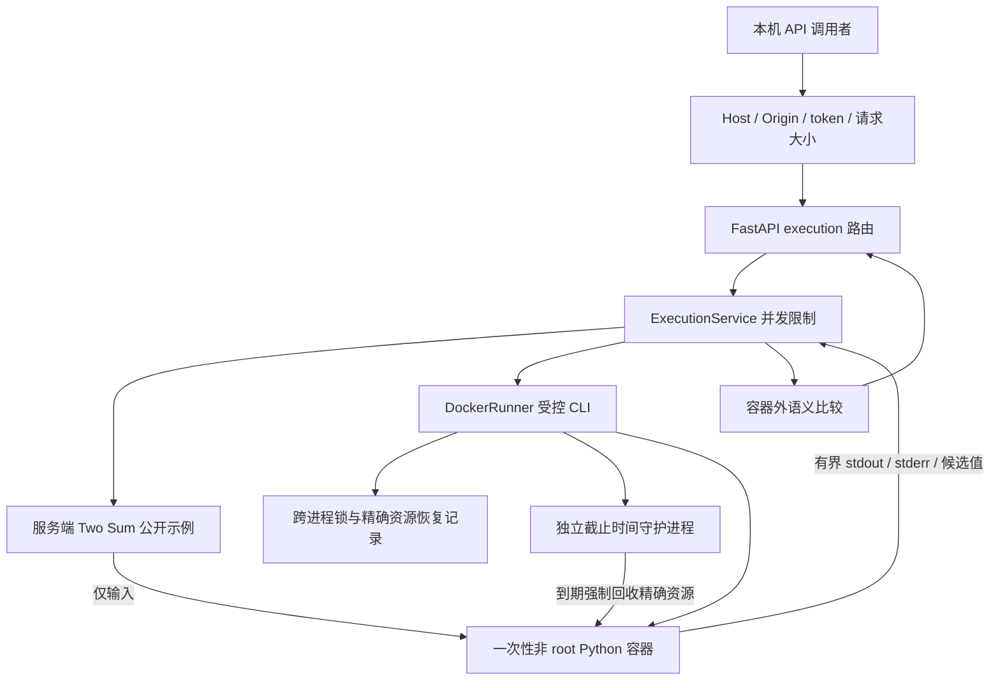

# M1：Python Docker 执行引擎

> 阶段说明：本文保留 M1 当时的范围与设计。Day 1 已完成网页运行接入，见 [Day 1 验收](../outputs/m3-lite-acceptance-report.md)。下文“前端尚未接入”等表述是 M1 阶段状态；当前功能和启动方式以 [README](../README.md) 与 [Day 2 验收](../outputs/day2-final-acceptance-report.md) 为准。

M1 在现有 FastAPI 中增加独立执行 API，只支持 Python、题号 1（Two Sum）的一个公开示例。前端运行 UI、完整本地判题集和 Java/C/C++ 运行属于后续阶段。

## 架构检查与实现范围

开发基准为 `main` / `9911e0524ee3dc9e9d9f79d91b4c5552bf2bcc33`。原有路由集中在 `D:/Projects/Python/ai-programming-tutor/backend/app.py`；React 工作台使用受控 Monaco 和题目/语言独立草稿；题库为 32 题、8 阶段、128 份模板。每题只有展示字符串示例，没有正式判题集。

原有 AI 两阶段诊断、严格三级 Hint、Streamlit、草稿和学习活动服务保持原行为。执行不调用 AI 工作区同步，不保存诊断/提交，不点亮绿墙、不提高画像、不标记 LeetCode 通过。



现有 `GET /api/health` 的 `execution_available=false` 保留，代表前端尚未接入执行功能。执行会话接口提供独立能力说明；`enabled` 是配置状态，`engine_verified=false` 明确不把配置冒充现场验证。每次运行都会检查 Engine 和本地镜像。

## 启动

先手动启动 Docker Desktop，确认 Linux Engine。首次准备镜像可由负责人执行：

```powershell
docker pull python:3.12-slim
```

执行服务本身使用 `--pull=never`，镜像不存在时返回系统错误，绝不自动联网补装。

在 VS Code 的 PowerShell 终端：

```powershell
Set-Location 'D:\Projects\Python\ai-programming-tutor'
$env:AI_TUTOR_EXECUTION_ENABLED = '1'
& 'D:\anaconda\envs\ai-study\python.exe' -m uvicorn backend.app:app --host 127.0.0.1 --port 8000
```

默认不启用执行；无需修改 `.env`。执行配置只读当前进程的 `AI_TUTOR_EXECUTION_*`，不调用 dotenv。关闭该终端即结束本次临时环境设置。

固定本机入口为 `127.0.0.1/localhost:8000`，兼容 Vite 的 `:5173` 同源代理。M1 不提供公网认证体系，请保持监听 `127.0.0.1`。

M1 按单个 Uvicorn 进程启动，不加 `--workers`。跨进程文件锁用于防止多个实例同时占用执行资源；执行 token 仍属于各自进程，不提供多 Worker 共享会话。

## API 使用

1. `GET /api/execution/session`：取得当前后端进程的执行 token 和能力说明；无 Docker 操作。
2. `POST /api/execution/run`：携带 `X-Execution-Token`，同步执行短时任务。

同一 PowerShell 会话中的调用示例：

```powershell
$session = Invoke-RestMethod 'http://127.0.0.1:8000/api/execution/session'
$source = @'
class Solution:
    def twoSum(self, nums, target):
        return []
'@
$body = @{
    problem_id = 1
    language = 'python'
    code = $source
    request_id = [guid]::NewGuid().ToString()
} | ConvertTo-Json
$result = Invoke-RestMethod `
    -Uri 'http://127.0.0.1:8000/api/execution/run' `
    -Method Post `
    -Headers @{ 'X-Execution-Token' = $session.token } `
    -ContentType 'application/json; charset=utf-8' `
    -Body ([System.Text.Encoding]::UTF8.GetBytes($body))
$result | ConvertTo-Json -Depth 12
```

这份占位代码应执行成功但示例失败。显式 UTF-8 字节传输也避免中文经 PowerShell 管道时产生编码歧义。

请求只允许 `problem_id/language/code/request_id`。`request_id` 可省略，由服务端生成；它在 M1 只用于关联，不提供重试幂等保证。客户端不能覆盖 input、测试、期望值、镜像、命令、环境或资源限制。

响应字段包括 `status/stdout/stderr/exit_code/execution_time_ms/language/problem_id/request_id/error_message/error_code/cleanup_confirmed/limits/judge`。

状态：`SUCCESS`、`RUNTIME_ERROR`、`COMPILE_ERROR`、`TIME_LIMIT_EXCEEDED`、`OUTPUT_LIMIT_EXCEEDED`、`MEMORY_LIMIT_EXCEEDED`、`SYSTEM_ERROR`。

- `SUCCESS` 只表示执行得到有效返回，正确性看 `judge.all_passed`。
- 当前范围始终是 `judge.scope=public_examples`，仅 1 个公开示例。
- 正确性在容器外验证不同且合法的两个索引，并用原始输入核验和；接受两种索引顺序。
- 不返回 Accepted；`official_accepted` 始终 false。
- 语法、运行、资源与基础设施错误分别处理；退出 137 本身不等于内存超限。
- 耗时从启动 attach 到终止观测，含启动/驱动/通信开销，不是纯算法时间。
- 不支持的题目/语言明确拒绝，不生成虚假测试结果。

权限校验只作用于新增执行路由：本机客户端、固定 Host、可信 Origin、拒绝 cross-site、进程随机 token。无开放 CORS。该 token 是本机执行能力保护，不是多用户登录或公网授权。

## 安全与资源配置

| 配置 | 默认值 / 实现 |
|---|---|
| 内存 | 128 MiB，memory-swap 与 memory 相同 |
| CPU | 0.5 核配额 |
| PID | 64，包含线程 |
| 运行墙钟 | 3 秒，容器外控制 |
| 管理/准备命令 | 单条默认 15 秒；停止/确认另有短限时 |
| stdout / stderr | 分别 65,536 字节，边读边限制，超限终止 |
| 源码 | UTF-8 65,536 字节 |
| JSON 请求 | 524,288 字节，解析前按真实接收量限制 |
| 临时区 | 16 MiB tmpfs，nosuid/nodev/noexec |
| 文件 | 单文件 16 MiB，core dump 关闭，fd 上限 128 |
| 全局并发 | 同一系统用户/锁目录下单任务；忙时 429 |
| 用户 | UID/GID 65534 |
| 根文件系统 | 只读 |
| 网络 | none，仅自身 loopback |
| 提权 | cap-drop ALL、no-new-privileges |
| seccomp | 保留 Docker 默认 builtin 策略 |
| 日志 | Engine log-driver none，输出仅通过有界 attach 管道 |
| 宿主挂载 | 无；无 Docker Socket/named pipe 暴露 |

服务端可配置例如 `AI_TUTOR_EXECUTION_MEMORY_MB`、`CPU`、`PIDS`、`TIMEOUT_SECONDS`、`PREPARE_TIMEOUT_SECONDS`、`STDOUT_LIMIT`、`STDERR_LIMIT`、`IMAGE` 等。所有值有范围校验；M1 并发固定为 1，不能通过客户端提升。对提高源码/请求上限的设置，API schema 和容器传输仍有独立硬上限，不承诺任意放大。

容器输入通过 stdin JSON 传递；宿主命令只使用固定 argv，`shell=False`。学生代码与固定驱动只在容器内加载执行，期望值不进入容器。结果协议只传不可信候选值，不能作为容器自报 verdict/资源耗用的认证依据。协议有重复键、深度、数量和有限数值校验。

每次运行先解析本地镜像 ID，再按该 ID 创建，防止过程中 tag 变化。默认 tag 仍需负责人维护；要复现验收版本可将 IMAGE 配置为批准的 digest。

## 生命周期、清理与恢复

同步 M1：校验权限与请求 → 并发锁 → 恢复前次资源 → Engine/镜像预检 → 持久记录随机名称 → 启动独立守护 → 创建 → attach 执行 → 获取退出/OOM 证据 → 删除并确认 → 返回结果。

- 普通超时和输出超限由父控制器 kill 容器，不能只杀 Docker CLI。
- 后台进程不能在该容器结束后继续运行。
- 不使用 `--rm` 提前丢失 OOM/退出证据；采证后显式 rm 并确认精确名称不存在。
- 同用户临时目录保存不含源码的精确资源名称，跨进程文件锁限制并发。
- 独立 watchdog 在总截止时间后回收该精确随机名称；正常清理确认后才停止守护。
- 创建响应丢失时，立即查询不存在不能证明不会迟到创建。保留观察期、守护、恢复记录和锁，关闭后续执行，避免放行潜在孤儿。
- 清理未确认时返回 SYSTEM_ERROR，并暂停该服务实例。恢复前先确认 Docker 健康，等观察期结束后重启后端；新 runner 先处理恢复记录，再放行新任务。
- 不删除其他 Docker 资源，不执行全局 prune。

Engine 长时间不可用、宿主重启或所有控制进程被同时终止时，不能保证即时回收；恢复记录用于后续对账。这些情形不能声称已经全部通过真实故障注入。

## 测试

普通自动化只 Mock Docker，不要求 Engine，也不运行学生代码：

```powershell
Set-Location 'D:\Projects\Python\ai-programming-tutor'
& 'D:\anaconda\envs\ai-study\python.exe' -B -m unittest discover -s tests -v
```

真实集成必须显式启用；缺 Engine/镜像时跳过并说明，绝不自动拉取：

```powershell
$env:AI_TUTOR_DOCKER_INTEGRATION = '1'
try {
    & 'D:\anaconda\envs\ai-study\python.exe' -B -m unittest discover -s tests -p test_docker_integration.py -v
} finally {
    Remove-Item Env:\AI_TUTOR_DOCKER_INTEGRATION
}
```

集成测试使用临时锁目录、公开输入和合成代码，不写学习记录、不调用 AI；前后校验正式 JSON 哈希，每例检查资源无新增残留。Engine 故障主要通过 Mock 验证，避免停止用户 Docker。

## M2：四语言扩展设计（未实施）

每种语言独立受控运行时配置：镜像、编译/运行 argv、两个阶段超时、内存/PID、产物预算、驱动版本。Java 使用固定 Solution/Main、UTF-8 和 javac/JVM；C 使用 GCC/C17 并处理 returnSize/returnColumnSizes；C++ 使用 G++/C++17 和原有 STL/节点接口。编译也进入沙箱，产物仅在沙箱执行，不在宿主加载。

按题目 manifest 选择驱动；链表、环、树和矩阵逐类适配。Two Sum、分组、子集和排列使用不同语义比较器，不能用一个递归排序器或同一通用入口替代32种接口。域未冻结、驱动未验证的组合不开放正式判题。

## M3：自动判题与前端接入设计（未实施）

三栏保持不变，在 CodePanel 底部增加执行结果；AssistantPanel 继续只负责 AI。运行公开示例与正式本地测试使用不同按钮与来源说明。当前本地提交按钮仍只记录学习活动，未来判题提交需新契约，不能静默改变旧统计规则。

正式集必须服务端独立管理、版本化且非空，全要求通过才返回本地 Accepted；私有输入、期望和可打印隐藏输入的 stdout 不透传。

接入 UI 前增加持久任务队列、所有权、幂等创建/查询/取消，以及独立 source_revision、run_generation、execution_id 和 client_request_id。执行不能调用旧 AI nextSnapshot/_sync。编辑、切题、切语言和取消先使执行快照失效；服务端收到独立失效通知，前端最终仍比对完整快照和结果版本，丢弃迟到响应。AbortController 不代替服务端取消。

## 部署边界

M1 的 Docker 控制器仍在本机 API 进程中，拥有高权限 Engine 访问能力；独立 watchdog 不是隔离执行 Worker。公网前须将管理权限迁至独立身份/节点的 Worker，补齐认证、配额、持久调度和故障恢复，并独立评估 gVisor/microVM。容器不是绝对安全，当前功能不等于生产恶意代码隔离验收。

参考：[Docker start](https://docs.docker.com/reference/cli/docker/container/start/)、[资源限制](https://docs.docker.com/engine/containers/resource_constraints/)、[默认 seccomp](https://docs.docker.com/engine/security/seccomp/)、[日志配置](https://docs.docker.com/engine/logging/configure/)。
