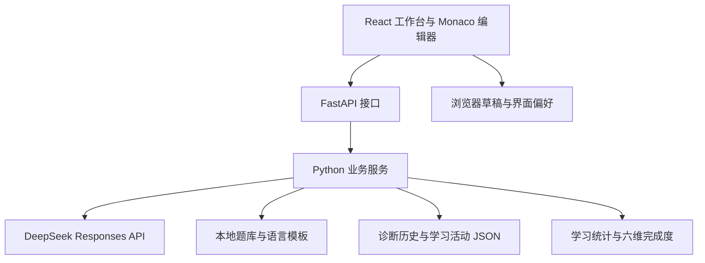

# AI Programming Tutor 项目阶段报告

**报告日期：**2026 年 11 月 3 日

**当前阶段：**第三阶段开发完成，进入人工验收与产品完善阶段

**源码版本：**`9911e05`，已同步至 GitHub 的 `main` 分支

**项目仓库：**https://github.com/elvory/ai-programming-tutor

## 一、项目概述

AI Programming Tutor 是面向算法学习者的 AI 编程辅导平台，也是“人工智能概论”课程实践项目。项目将算法题库、在线代码编辑、渐进式提示和学习记录整合到同一个工作台，帮助学习者在保留独立思考的同时获得针对性指导。

项目最初以 Python 练习和代码诊断为基础，目前已完成 React 工作台升级，并扩展到 Python 3、Java、C、C++ 四种语言。当前版本覆盖 32 道精选题、八阶段学习路线，以及每道题四种语言的初始模板，共 128 份代码骨架。

主要学习流程为：

> 选择题目 → 选择语言 → 独立编写代码 → 请求 AI 诊断 → 逐级查看 Hint → 记录练习 → 确认外部通过情况 → 查看学习进度与下一阶段建议。

当前成果是可在本地运行、具有自动化验收记录的教学原型。系统已经接入外部大语言模型，但尚未开展真实学生教学效果实验，因此暂不能据此判断学习成绩或效率的提升幅度。

## 二、项目目标与当前进展

| 建设目标 | 当前成果 | 状态 |
|---|---|---|
| 建立算法练习基础 | 32 道精选题、八阶段路线、题目搜索与筛选 | 已实现 |
| 提供专业编辑体验 | Monaco 编辑器、三栏工作台、全屏、字号与布局调整 | 已实现 |
| 支持多语言学习 | Python 3、Java、C、C++ 编辑及对应模板 | 已实现 |
| 保护练习草稿 | 按题目和语言保存，兼容旧 Python 草稿，支持备份与导入 | 已实现 |
| 提供渐进式 AI 辅导 | DeepSeek 结构化诊断和三级 Hint | 已实现，四语言真实回答质量待人工验收 |
| 记录学习过程 | 诊断历史、本地提交、语言标签和用户自报通过状态 | 已实现 |
| 展示学习进度 | 365 天绿墙、连续学习统计、六维完成度与推荐题单 | 已实现 |
| 在线执行与自动判题 | 安全编译、运行及测试用例判定 | 尚未实现，作为后续独立任务 |

## 三、技术架构

### 3.1 技术栈

| 层级 | 使用技术 | 主要作用 |
|---|---|---|
| 前端界面 | React、TypeScript | 构建页面交互，约束前端数据类型 |
| 开发与构建 | Vite、npm | 开发服务、依赖管理与生产打包 |
| 代码编辑 | Monaco Editor | 四语言高亮、基础补全、缩进与多行编辑 |
| 图表和样式 | Recharts、Lucide React、CSS | 雷达图、图标、深色主题与响应式布局 |
| 后端接口 | Python、FastAPI、Pydantic | 提供接口、校验参数并组织业务服务 |
| 后端运行 | Uvicorn | 启动 API，并提供构建后的前端页面 |
| AI 集成 | DeepSeek Responses API、JSON Schema | 返回结构化诊断与三级提示 |
| 配置管理 | python-dotenv | 在服务端加载 `.env` 配置 |
| 数据存储 | JSON、localStorage、sessionStorage | 保存题库、学习记录、草稿和会话信息 |
| 测试与版本 | unittest、Vitest、React Testing Library、Playwright、Git、GitHub | 功能验证与代码版本管理 |

原有 Streamlit 与 Ace Editor 的 Python 界面继续保留，新版工作台通过 FastAPI 复用 Python 业务服务。

### 3.2 系统结构



浏览器负责交互和草稿保存，后端负责参数校验、诊断请求、记录持久化与统计。模型密钥仅由服务端加载，前端通过业务接口发起诊断。

## 四、已完成的核心功能

### 4.1 题库与学习路线

本地题库包含 32 道经典算法题，支持题号、中文或英文题名搜索，并可按难度和标签筛选。八阶段路线依次覆盖数组与哈希表、双指针与滑动窗口、栈与二分、链表、二叉树与递归、搜索与回溯、贪心和动态规划。

题目页面提供练习摘要、示例、约束和官方链接。仪表盘的推荐题单默认显示推荐阶段，可切换阶段并直接进入对应题目。题库摘要与示例为本地内容，完整题意及最新接口以 LeetCode 官方页面为准。

### 4.2 多语言工作台

工作台采用题目、代码、AI 辅导三栏布局，支持独立滚动、面板拖动、编辑器全屏、字号调整和手机页签切换。

四种语言分别使用对应的 Monaco 语言模式和独立编辑模型。每种语言覆盖全部 32 道题的模板；链表、二叉树、字符网格和 C 多维返回值具有各自的接口约定。

模板是待实现的函数骨架，不是完整算法答案。编辑器提供高亮、基础代码片段和词汇补全，尚未接入完整语言服务器或 IDE 级语义分析。

### 4.3 按题目和语言隔离的草稿

同一道题的四种语言使用独立草稿，切换题目或语言不会覆盖其他代码。原 Python 草稿键继续保留，导入兼容旧格式，冲突时保护已有内容。

系统支持刷新恢复、备份导出、草稿导入和有意清空的代码保存。浏览器存储失败时，当前标签页保留最新内存内容，并提供明确标注的部分备份。草稿尚不支持跨设备同步。

### 4.4 DeepSeek 诊断与三级 Hint

后端向模型提供题目上下文、当前代码、语言标识及该语言的检查重点，要求返回错误类型、知识点、分析和三级 Hint。

| 提示级别 | 教学作用 | 预期内容 |
|---|---|---|
| Hint 1 | 提示方向 | 指出应关注的概念、条件或边界 |
| Hint 2 | 帮助定位 | 使用简单示例或局部推演缩小问题范围 |
| Hint 3 | 说明修改思路 | 进一步解释局部调整方向，避免直接给出整题答案 |

一次模型请求生成三级提示，初始只展示第一级，后续由用户逐级展开。展开提示不会再次调用模型，使用情况会记录到对应诊断历史。

服务端保留 Responses API、JSON Schema 和严格校验，要求恰好三条非空 Hint。401、402、429、超时、空响应、非法 JSON、缺字段等情况会明确报错，不保存为成功诊断。

诊断采用候选结果与浏览器确认两个步骤，并检查题目、语言、代码、修订号和请求标识，隔离切题、编辑、切换语言或快速重复请求后到达的旧结果。

### 4.5 学习记录与统计

诊断、提交和通过确认分别记录，统计含义如下：

| 操作 | 增加本地提交次数与绿墙 | 增加完成题数 |
|---|---|---|
| AI 诊断 | 否 | 否 |
| 记录本地提交 | 是 | 否 |
| 用户确认在 LeetCode 通过 | 否 | 按不同题号去重 |

新记录携带语言，旧记录缺少语言时显示“未记录”。总体完成状态与分语言状态分别处理，避免将一种语言的通过情况错误归到另一种语言。

学习仪表盘保留过去 365 天提交绿墙、累计提交、连续学习天数和推荐阶段。日期按北京时间统计，通过状态来自用户确认，尚未同步官方判题结果。

## 五、六维算法完成度画像

系统以原学习阶段作为主要分类依据，将 32 道题映射到六个方向，每道题只归入一个主要维度。

| 主要维度 | 对应阶段 | 题库题数 |
|---|---|---:|
| 数组与哈希表 | 1 | 4 |
| 双指针与滑动窗口 | 2 | 4 |
| 栈、队列与二分查找 | 3 | 4 |
| 链表、二叉树与递归 | 4、5 | 8 |
| DFS、BFS 与回溯 | 6 | 4 |
| 贪心与动态规划 | 7、8 | 8 |

计算规则为：

```text
维度完成度 = 用户确认通过的不同题目数 ÷ 该维度题库题目数 × 100%
```

同题使用四种语言通过仍只算一道题；诊断、Hint 和本地提交不提高画像百分比。雷达图使用 0—100 坐标，悬停可查看完成数与总题数，并提供方向比较和下一步练习建议。

少于三道不同题目通过时，界面提示样本不足，暂不判断强弱；该阈值仅为 V1 展示规则，不是统计置信度。0% 表示尚未记录完成，不代表真实能力为零。画像当前反映的是题库完成度，不能直接推断准确率、面试水平或真实算法能力。

## 六、测试与验收情况

以下结果来自 **2026 年 11 月 2 日第三阶段自动化验收**。本报告于 11 月 3 日复核已有记录，没有重新运行整套测试。

| 验证项目 | 记录结果 | 范围与说明 |
|---|---|---|
| Python 自动化测试 | 136 项通过 | 原 106 项、多语言后端 16 项、模板 9 项、画像 5 项 |
| 前端与 React 组件测试 | 37 项通过 | 共 8 个测试文件 |
| 浏览器检查 | 107 项通过 | 新主流程 70 项、重开恢复 4 项、原流程 13 项、边界 17 项、迁移 3 项 |
| TypeScript 与生产构建 | 已通过 | 类型检查和 Vite 构建 |
| Python 语法与差异检查 | 已通过 | 32 个项目 Python 文件解析及文本格式检查 |
| 模板验证 | 部分通过 | 32 份 Python 语法解析、32 份 Java 编译通过；C/C++ 为静态复核 |
| 正式数据保护 | 已通过 | 阶段验收记录显示三个正式文件开发前后 SHA-256 一致 |
| ESLint | 未测试 | 当前项目未配置 |
| 四语言真实模型回答质量 | 未测试 | 本阶段模型 HTTP 响应使用 Mock |
| 官方在线接口与判题 | 未测试 | 未连接官方判题系统 |

浏览器检查使用真实前端、FastAPI、Python 业务服务和临时 JSON 数据，DeepSeek HTTP 响应由 Mock 替代，本阶段真实模型请求为零次。前期已有负责人实际调用 DeepSeek 成功的记录，但四语言回答质量仍需单独进行真实人工验收。

自动化覆盖了四语言切换、中文与空草稿保存、切题和刷新恢复、关闭浏览器后恢复、三级 Hint、过时请求隔离、本地提交、历史、绿墙、画像、题单跳转和窄屏布局。模拟超时等边界测试用于确认失败不会创建成功诊断或覆盖草稿。

## 七、当前限制

1. **尚无安全代码执行与自动判题。** 示例面板只展示题库示例和预期输出，不产生实际运行结果、运行时间或自动 Accepted。
2. **模型教学质量缺少系统评测。** 功能联调通过不等于诊断内容始终正确，仍需使用真实案例评价提示质量。
3. **C/C++ 编译验证尚未完成。** 当前已复核签名、头文件、节点与返回值约定，实际编译和最新在线接口仍待检查。
4. **存储与部署能力面向本地场景。** JSON 并发保护针对单个 Python 进程，尚未提供完整账号体系与跨设备草稿同步。
5. **补全为基础能力。** 当前没有完整语言服务器、类型推断或 IDE 级语义分析。
6. **尚无真实教学效果与并发性能结论。** 未进行学生对照实验或系统压力测试，不能报告学习提升比例、模型准确率或大规模并发能力。

## 八、下一阶段建议

| 优先级 | 建议任务 | 建议验收标准 |
|---|---|---|
| P0 | 四语言真实 AI 人工验收 | 检查语言匹配、提示递进、整题答案泄露及失败处理 |
| P0 | 模板与日常草稿验收 | 补充 C/C++ 编译，对照官方接口，验证旧草稿、切题、刷新、重开和备份恢复 |
| P1 | 建立提示质量评价集 | 固定题目与代码样例，区分内容质量和接口稳定性，保留人工评价结果 |
| P1 | 完善工程与部署准备 | 按需求补充 ESLint、加载优化、备份机制和数据库迁移方案 |
| P2 | 独立设计执行与判题系统 | 先定义隔离、资源限制、超时、网络权限和测试用例规范，再实施验收 |

当前优先级是补齐真实使用证据和数据可靠性，再按实际需求扩展部署规模与代码执行能力。

## 九、运行方式与交付材料

在项目根目录启动新版后端：

```powershell
Set-Location 'D:\Projects\Python\ai-programming-tutor'
& 'D:\anaconda\envs\ai-study\python.exe' -m uvicorn backend.app:app --host 127.0.0.1 --port 8000
```

浏览器访问：`http://127.0.0.1:8000/`。如果已有后端运行，需先停止原进程再启动新版本。首次安装或更新前端代码后，还需安装依赖并构建前端。真实诊断依赖服务端配置，主动请求模型可能产生 API 费用。

主要材料包括：

- `README.md`：项目说明与运行方法。
- `docs/phase3.md`：多语言、草稿、记录和画像规则。
- `docs/template-interfaces.md`：32 道题的多语言接口与验证范围。
- `outputs/phase3-verification.md`：第三阶段验收证据、文件清单和数据哈希。
- `outputs/phase3-*-results.json`：浏览器检查结果明细。

## 十、阶段结论

AI Programming Tutor 已形成多语言编辑、AI 渐进提示、独立草稿、学习历史和完成度展示相结合的主要学习流程。当前阶段完成了可演示的产品原型与功能验收，源码版本已同步 GitHub。后续重点是补充四语言真实模型评价、模板编译和日常使用验收，并根据实际需求推进持久化、部署及安全执行方案。
