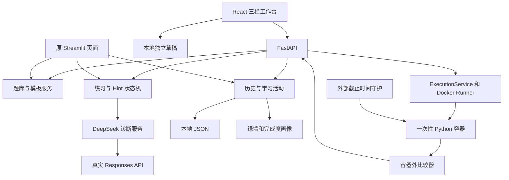
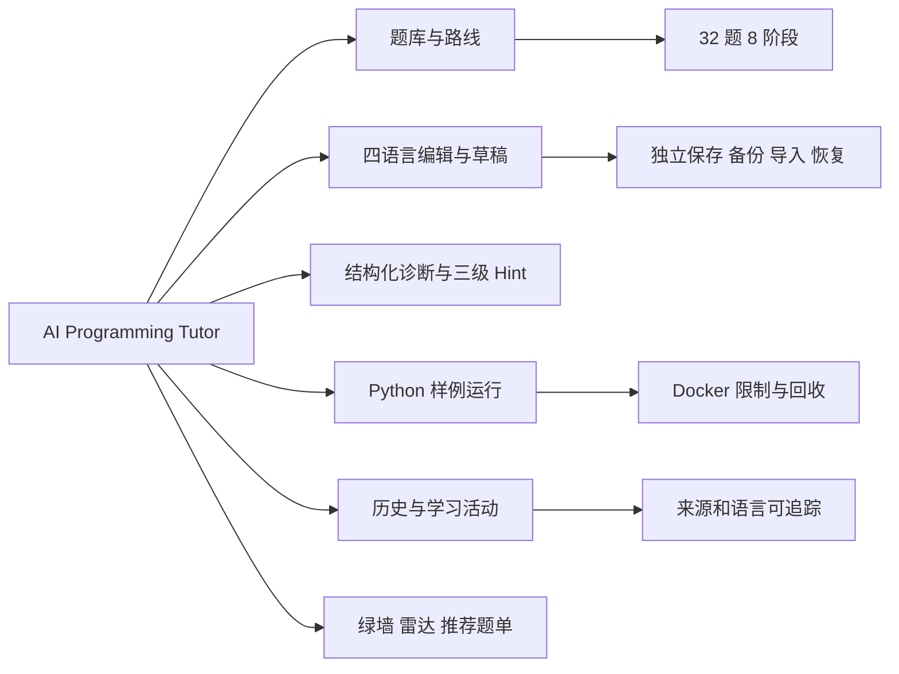
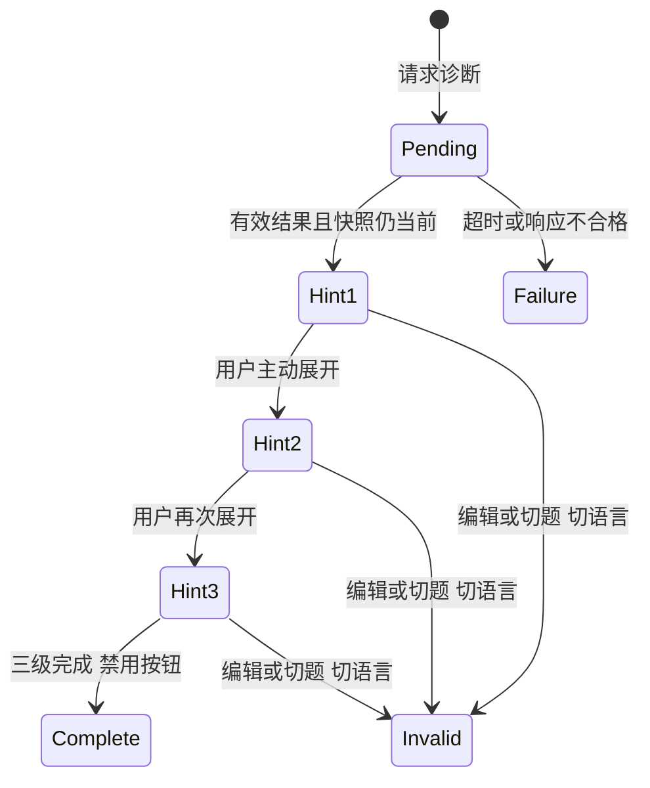

# AI Programming Tutor 答辩文字素材

材料日期：2026-11-09。适用于当前本地课程教学原型；所有数字以 [Day 2 验收](day2-final-acceptance-report.md) 为准。本文是制作 PPT 的文字稿，不是已生成的幻灯片。

## 1. 一句话介绍与问题背景

AI Programming Tutor 把精选算法题、四语言草稿、结构化 AI 辅导、渐进 Hint、学习记录和一个安全执行样例放进同一工作台，帮助学习者先定位问题，再逐步修改代码。

课程关注的问题：初学者往往只看到报错或答案，缺少题意、代码上下文与可追踪的思考过程。项目尝试把“选题—编辑—运行样例—理解问题—按需取 Hint—主动记录学习”连成闭环。

边界表述：这是本地教学原型，不是 LeetCode 官方判题系统、完整在线评测平台或生产级恶意代码沙箱。

## 2. 已完成的功能与数字

| 交付项 | 可展示的事实 |
|---|---|
| 精选题库 | 32 道题、8 阶段 |
| 多语言 | Python、Java、C、C++ 编辑与独立模板，共 128 份 |
| 草稿 | 题目/语言隔离，备份、导入、恢复 |
| AI | DeepSeek Responses 结构化诊断，3 级 Hint |
| 学习跟踪 | 诊断历史、主动提交、365 天绿墙、推荐题单 |
| 画像 | 6 个算法方向的题库完成度雷达 |
| 执行 | Python + Two Sum，一个公开示例的 Docker 网页运行 |

不要把“128 份模板”说成“128 种题目/语言自动判题全部完成”。Java/C/C++ 当前只编辑和诊断，不执行。

## 3. 技术栈

- 前端：React、TypeScript、Vite、Monaco、Recharts、Lucide React、CSS。
- 后端：Python、FastAPI、Pydantic、Uvicorn；兼容原 Streamlit/Ace 页面。
- AI：DeepSeek Responses API、JSON Schema、服务端 dotenv 配置。
- 存储：JSON 与浏览器 localStorage/sessionStorage，没有 SQLite、账号或云端同步。
- 执行：Docker Desktop/WSL2 Linux Engine、受控 CLI、独立截止时间守护。
- 验证：unittest、Vitest/RTL、Playwright 和独立 Docker 集成。

可选讲解：“保持已有 React + FastAPI 与 Python 服务，功能逐步接入，没有为了代码执行重建项目。”

## 4. 系统架构图

讲解要点：AI 与执行是独立链路。AI 发送题目上下文和代码，执行只运行服务端适配的公开输入。运行不会自动调用 AI，也不会自动增加提交或通过数。

当前 Runner 与 API 同进程，有 Docker 管理权限；独立守护不是独立执行 Worker。这个限制应主动说明。

## 5. 功能模块图

推荐按页面顺序演示，不逐个背诵内部文件名。

## 6. AI 三级 Hint 机制

输入：题号、题目摘要/示例/约束、当前语言与代码。

输出：`error_type`、`knowledge`、`analysis`、恰好三条非空 `hints`。JSON Schema 提供结构约束，服务端仍进行严格校验；不合格响应不保存成成功诊断，不用 Mock 冒充 AI。

前端先确认候选诊断仍属于当前代码，再接受并写历史。题目、语言、代码和请求修订共同隔离旧响应；Hint 重试不额外跳级。

本轮真实示例：模型指出 `nums[i+1]` 越界和只检查相邻元素的问题。Hint 1 追问题意，Hint 2 用非相邻反例推演，Hint 3 提醒索引对的关系；未给完整可提交程序。只调用一次真实模型，其余自动化诊断均为 Mock。

## 7. Docker 执行与安全配置

LeetCode 模板是函数接口，需要驱动构造参数并调用 `Solution.twoSum`；不能把代码当普通 stdin/stdout 程序就宣称判题完成。

流程：校验请求与本机权限 → 限制并发 → 准备临时容器 → 输入代码和公开测试数据 → 调用函数 → 有界捕获输出/候选值 → 容器外比较 → 确认清理 → 展示结果。

| 安全项 | 当前值或做法 |
|---|---|
| 账号权限 | 非 root UID/GID 65534 |
| 网络/文件 | network none、只读根目录、16 MiB tmpfs、无宿主挂载 |
| 提权 | cap-drop ALL、no-new-privileges、默认 seccomp |
| 内存/CPU/PID | 128 MiB / 0.5 核配额 / 64（包含线程） |
| 时间 | 3 秒外部墙钟限制；准备与清理另有上限 |
| 输出 | stdout/stderr 各 64 KiB，流式限制，超限终止 |
| 清理 | 精确资源名、独立守护、恢复记录和失败关闭 |
| 秘密 | 容器不加载项目 .env，不传宿主密钥或 Docker Socket |

最终比较在容器外，学生输出不是可信 verdict。Two Sum 按原始输入检查索引合法、不同且和正确，允许索引顺序不同。

三种状态必须分清：“程序运行成功”“当前公开示例通过”“用户自报 LeetCode 官方通过”。当前没有全题正式 Accepted。Docker 共享内核，也不能承诺绝对安全。

## 8. 绿墙和六维雷达图如何解释

绿墙：按北京时间统计主动“记录提交”的活动日，展示 365 天；诊断、Hint 和运行不点亮绿墙。用户自报通过与提交分开保存。

六维完成度：

| 维度 | 阶段 | 分母 |
|---|---|---:|
| 数组与哈希表 | 1 | 4 |
| 双指针与滑动窗口 | 2 | 4 |
| 栈、队列与二分查找 | 3 | 4 |
| 链表、二叉树与递归 | 4、5 | 8 |
| DFS、BFS 与回溯 | 6 | 4 |
| 贪心与动态规划 | 7、8 | 8 |

公式：本维度已自报通过的不同题号数 ÷ 本维度题数 × 100%。同题多语言完成不重复增加总体完成数。少于三道不同题目时提示样本不足；三道是展示阈值，不是统计置信度。

截图中的“3/32、50%、25%”来自临时模拟学习事件，由真实服务计算，不是作者个人成绩，也不是模型推断的算法水平。

## 9. 核心截图清单与来源

| 素材 | 适合展示 | 来源与标注 |
|---|---|---|
| [day2-capability-desktop.png](day2-capability-desktop.png) | 学习概览、绿墙、雷达图和路线 | 临时模拟学习事件，真实服务计算 |
| [day2-capability-detail.png](day2-capability-detail.png) | 绿墙下题单与六维图细节 | 同上；非个人成绩 |
| [day2-capability-empty.png](day2-capability-empty.png) | 无已通过样本时的提醒 | 临时数据；不把 0% 解释为能力为零 |
| [day2-capability-mobile.png](day2-capability-mobile.png) | 移动端概览顶部、指标和绿墙 | 390px，长内容可滚动 |
| [day2-java-workbench.png](day2-java-workbench.png) | Java 编辑器与独立草稿 | 临时草稿；不代表 Java 执行 |
| [day2-execution-desktop.png](day2-execution-desktop.png) | 三栏工作台和真实 Python 结果 | 真实 Docker，公开示例 |
| [day2-execution-mobile.png](day2-execution-mobile.png) | 移动端运行按钮与结果 | 真实 Docker，390px |
| [day2-live-ai.png](day2-live-ai.png) | 真实模型与已展开的三个 Hint | 一次真实 DeepSeek 请求、临时历史 |

这些均为本轮真实截图，不是设计稿。历史 outputs 图片保留，可补充备用，但沿用原报告的 Mock/真实来源标签。

## 10. 测试结果与工程质量

| 项目 | 本轮最终结果 |
|---|---|
| Python | 182 通过、15 默认跳过，共 197；跳过未算通过 |
| 真实 Docker 独立集成 | 串行重跑 15/15；首轮初始化超时单独记录；收尾引擎不可连接 |
| 前端 | 71/71 |
| 浏览器 | 35 + 70 + 71 个检查点，执行流程 10 次真实请求 |
| 真实 AI | 手动浏览器点击 1 次，模型 deepseek-flash，三级 Hint 成功 |
| 类型/构建/语法 | TypeScript、Vite、48 个 Python 文件和启动脚本检查通过 |
| 依赖 | pip check、npm ls 通过，无新增或升级 |
| 数据与 Git | 正式数据前后哈希一致，不暂存/提交/推送，不泄露密钥 |

讲解发现与修复：修正文档对执行范围的过时描述、补充忽略规则和启动指引、修复旧浏览器断言；没有为全绿降低 Docker 限制或删除测试。

## 11. 建议演示讲稿（约 3—5 分钟）

1. **定位**：“这是帮助学习者思考的本地算法工作台，先展示真实范围和边界。”
2. **编辑**：打开一道题，切换四种语言，展示独立草稿和恢复。
3. **执行**：回到 #1 Python，运行公开示例，说明状态、输出与用例比较。
4. **辅导**：对边界错误请求一次 AI，逐级展开 Hint，不直接展示完整答案。若网络或余额异常，用明确标注的本轮真实截图，不把 Mock 冒充实网。
5. **跟踪**：展示诊断历史；主动记录提交后绿墙改变；自报通过才改变完成度。
6. **工程**：展示测试表、数据保护和安全限制，最后说明未完成项。

演示前准备：收尾复查时 Docker Linux 引擎不可连接，先启动并确认可用，再按 README 构建、启动单进程后端；用临时数据演示提交/通过，避免修改个人记录。真实 AI 可能收费，不展示 `.env` 或请求认证头。

## 12. 已知不足与未来规划（未实施）

- 只支持一个 Python 公开示例，没有全题正式测试集或四语言执行。
- AI 建议有随机性，可能冗长或出错；需要更系统的教学质量评价。
- 草稿依赖浏览器，JSON 为本地记录，没有账号、跨设备同步和长期异步队列。
- 同步执行无取消；公网部署前须分离高权限 Worker、完善认证配额，并评估更强隔离。
- 可在未来独立阶段增加题目契约与测试集、更多语言、性能及依赖维护。本轮没有开始这些开发。

推荐回答：“当前结果证明最小教学闭环可用，但不证明已建成完整在线判题平台。后续扩展应先保证契约、测试质量和安全边界。”

## 13. 可选答辩问答

**为什么不是直接让 AI 判通过？** AI 给静态教学建议；执行与比较由受控容器和服务端规则完成，来源独立。

**为什么测试通过不点亮绿墙？** 绿墙记录用户主动提交，公开示例运行不能代表完成一道题。

**为什么四语言编辑都有，却只有 Python 能运行？** 编辑/诊断和编译/执行是不同能力；后者需要语言工具链、逐题驱动、资源预算和验证。

**为什么不用数据库或云服务？** 当前课程范围是单机原型，JSON 和浏览器存储足以验证闭环；没有把未实现的架构当成功能。

**Docker 是否绝对安全？** 否。当前最小权限和资源限制降低风险，但共享内核与高权限管理面仍需更强部署隔离。

**完成度能代表真实能力吗？** 不能。它只反映这 32 题中用户自报通过的覆盖率，界面有样本与来源说明。
